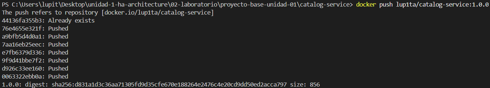
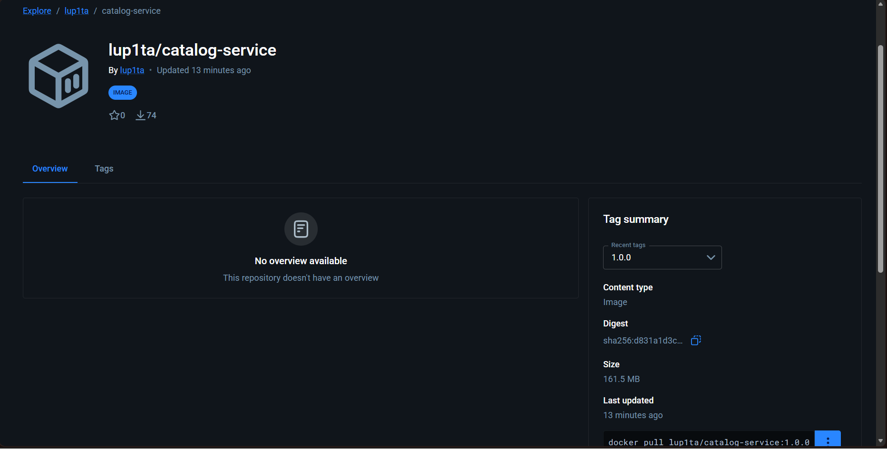
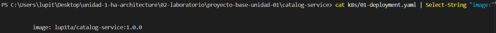
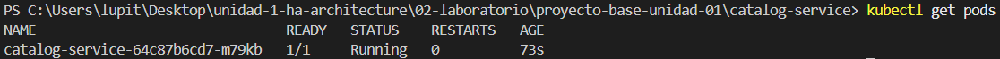
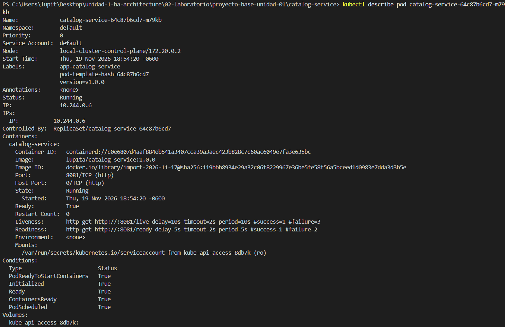
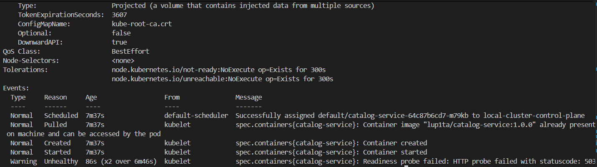
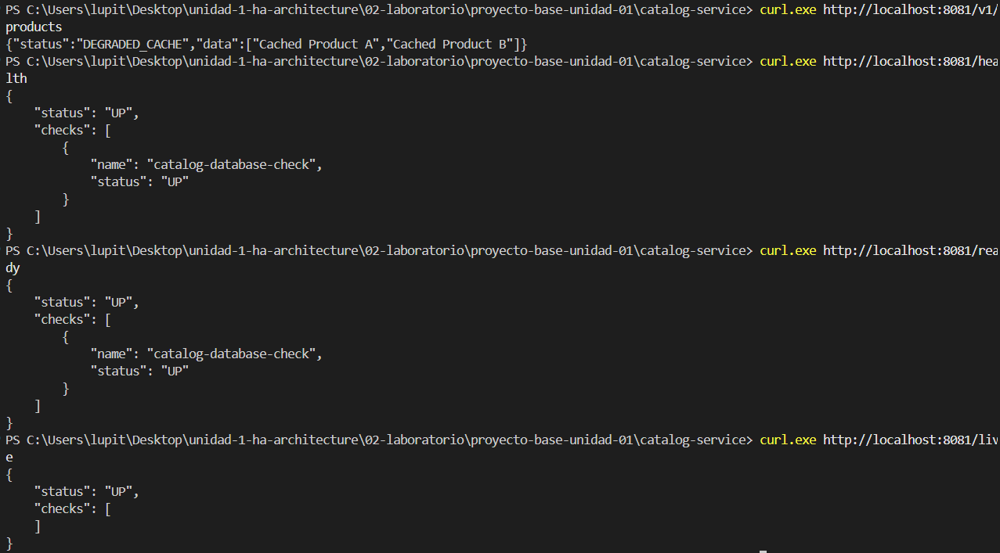
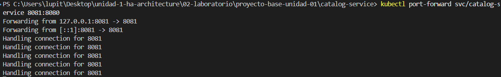

# Evidencias del laboratorio 1.3

Captura de `docker push` mostrando carga exitosa.

Acceso a https://hub.docker.com/r/lup1ta/catalog-service mostrando tag `1.0.0`

Captura del contenido de `k8s/01-deployment.yaml` mostrando tu usuario en el campo `image`

Captura mostrando 1 Pod en estado `Running` y `READY 1/1`

Captura de eventos (`kubectl describe pod`)

Validación de Funcionamiento del Servicio`

## Explicación técnica

El flujo completo de despliegue asegura la disponibilidad continua del servicio. Primero, se realiza el build local empaquetando la aplicación con Maven y construyendo la imagen con Docker, etiquetándola como `lup1ta/catalog-service:1.0.0`. Luego, se hace push a Docker Hub, subiéndola a un repositorio público para que sea accesible desde cualquier entorno.

En la fase de despliegue, el archivo `k8s/01-deployment.yaml` actúa como la declaración en Kubernetes, definiendo la imagen a utilizar y configurando las pruebas de salud. Al ejecutar `kubectl apply`, el clúster gestiona la descarga automática desde Docker Hub si la imagen no existe localmente.

Finalmente, Kubernetes ejecuta health checks automáticos: consulta la ruta `/ready` cada 5 segundos para confirmar si el contenedor está listo para recibir tráfico, y la ruta `/live` cada 10 segundos para verificar si el proceso sigue vivo.